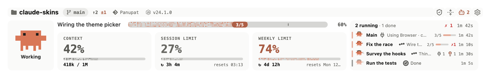
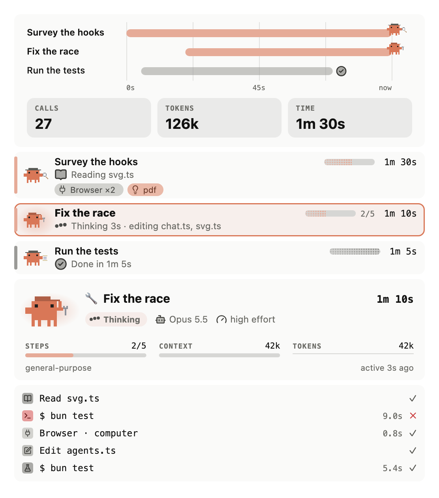
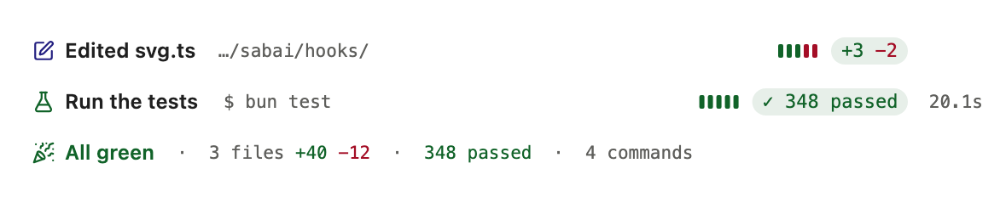
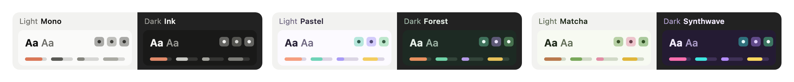

<div align="center">

# sabai

**See what Claude is doing, at a glance, in the Claude Code desktop app.**

A pixel-art status band above the prompt, a pane for subagents, and tool calls as one-line rows.

[](https://github.com/panupat-top/claude-sabai/actions/workflows/check.yml)
[](https://github.com/panupat-top/claude-sabai/releases/latest)
[](https://code.claude.com/docs)
[](LICENSE)

<picture>
  <source media="(prefers-color-scheme: dark)" srcset="docs/images/band-dark.png">
  
</picture>

</div>

## Features

### The band, above the prompt

- **Clawd** shows how the session is going: working, your turn, tests failing, all green, context full.
- **What Main is doing now:** the call in flight and its time, the turn's calls, the lines changed and the tests run.
- **Your limits:** context, the session limit and the weekly limit, amber and red at thresholds you set.
- **The race:** a row for Main and each subagent while they work, with what each is doing and how it ended.

### The Subagents pane

<picture>
  <source media="(prefers-color-scheme: dark)" srcset="docs/images/pane-dark.png">
  
</picture>

Open it from the robot icon or with `/sabai-agents`.

- **Now:** a timeline of the turn's subagents, a lane for Main and one for each subagent.
- **Each lane** says what it is doing (`Thinking 3s · editing svg.ts`), and which skills and MCP servers it used.
- **View** a run for its model and effort, plan, tools, calls, files and report.
- **Earlier** keeps the turns before, one line each.
- **Thai summary** (optional): Haiku sums up each finished subagent's report.

<br clear="right">

### Tool calls in the chat

<picture>
  <source media="(prefers-color-scheme: dark)" srcset="docs/images/chat-dark.png">
  
</picture>

- Each Edit, Write, Read and Bash call is one line: what it did and how it ended.
- Test runs (bun, jest, vitest, pytest, cargo, go) show their pass and fail counts.
- GitHub-style callouts (`> [!NOTE]`) become coloured boxes.
- A turn that did real work ends with a receipt: files, tests and commands.

### Themes

<picture>
  <source media="(prefers-color-scheme: dark)" srcset="docs/images/themes-dark.png">
  
</picture>

Pick one theme for light mode (**Mono**, **Pastel**, **Matcha**) and one for dark (**Ink**, **Forest**, **Synthwave**). The band and the panes switch with your system's appearance. Every theme keeps text at a 4.5:1 contrast ratio or better.

## Install

Requires Claude Code **2.1.287** or later and the desktop app's **Code tab**. Run in a terminal (the Code tab has no `/plugin install`):

```bash
claude plugin marketplace add panupat-top/claude-sabai
claude plugin install sabai@claude-sabai
```

Open a new Code tab session. In a terminal or `-p` session sabai stays out of the way entirely. Mods do not load in the desktop app's WSL sessions.

## Usage

| Command | Opens |
|---|---|
| `/sabai-settings` or the gear | Settings: layout, theme, usage, info row, Clawd, subagents, chat, guard, notifications |
| `/sabai-agents` or the robot | The Subagents pane |

Settings apply at once and stay for new sessions. Every part of the band can be hidden. The optional **guard** blocks or asks before risky commands (deleting your home folder, force-pushing `main`, reading `.env`, discarding uncommitted work); it is a safety net, not a sandbox.

The [guide](docs/guide.md) covers every part of the band, the pane and each setting in detail.

## Update and uninstall

```bash
claude plugin marketplace update claude-sabai
claude plugin update sabai@claude-sabai
```

```bash
claude plugin uninstall sabai@claude-sabai
```

Restart Claude Code after either one.

## For the terminal: hub

sabai leaves terminal sessions alone. For them, the repository carries **hub**, a two-line status line with the band's essentials (folder, branch, model, cost, context and limits). See [the guide](docs/guide.md#in-a-terminal-the-hub-status-line) to set it up.

## Privacy

sabai reads only what Claude Code gives a mod, and runs `git` and `node --version` in your project folder. It reads no other files, uses no credentials and makes no network requests of its own. With **Thai summary** on, a finished subagent's description, prompt, report, file names and failed calls go to Haiku through Claude Code's own API client; turn it off in Settings › Subagents to send nothing.

## Troubleshooting

| You see | Why |
|---|---|
| Nothing of sabai | It runs in the desktop app's Code tab only; open a new session after installing |
| No Session or Weekly limit | No reply yet in this session, or not a subscription plan |
| Not sure which version runs | The last line of Settings: `Release` is the installed copy, `Dev` one loaded from a folder |
| No Node or branch in the info row | `node` is not on Claude Code's `PATH`, or the folder is not a git repository |

More in the [guide](docs/guide.md#troubleshooting).

## Contributing

Issues and pull requests are welcome; start with [CONTRIBUTING.md](CONTRIBUTING.md). To report a security problem, see [SECURITY.md](SECURITY.md).

## Credits

Built by reading [hellosverre/claude-skins](https://github.com/hellosverre/claude-skins), [JohnnyVizz/claude-kit](https://github.com/JohnnyVizz/claude-kit) (Pixel Clawd, after DockCrab) and [data-goblin/claude-code-filetree](https://github.com/data-goblin/claude-code-filetree), all MIT. Icons from [Lucide](https://lucide.dev) (ISC) as animated by [pqoqubbw/icons](https://github.com/pqoqubbw/icons) (MIT), [Octicons](https://github.com/primer/octicons) (MIT) and [Simple Icons](https://simpleicons.org) (CC0). The logos are trademarks of their owners. Their notices are in [THIRD_PARTY_NOTICES.md](THIRD_PARTY_NOTICES.md).

## License

[MIT](LICENSE)

sabai is an independent community project. It is not affiliated with, endorsed by or sponsored by Anthropic. Claude, Claude Code and Clawd belong to Anthropic, PBC.
